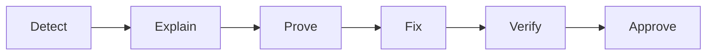

# Diffra

**Visual regressions, found and fixed by your agent.**

Diffra catches every pixel a pull request changes, tells your coding agent exactly why, helps it undo what nobody intended, and proves the fix worked. Self-hosted, and built for CI.

[Fix a regression with your agent](docs/getting-started/agent-quickstart.md) · [Documentation](docs/index.md) · [How it works](docs/concepts/how-diffra-works.md) · [Reference](docs/reference/index.md)

---

## From pixel diff to merged fix

Other tools stop at a picture of what changed and hand the problem to a person. Diffra keeps going. Every stage after detection is something an agent can call, and every stage produces evidence instead of a guess.

| Stage | What happens |
| :--- | :--- |
| **Detect** | Every pull request is captured and compared with the baseline it branched from. A Rust engine skips identical images and groups the rest into regions. |
| **Explain** | Each changed region is tied to the element, the style and the stylesheet rule behind it, and to whether that file changed in this branch. |
| **Prove** | Diffra undoes the suspected cause in the live page and checks that the pixels return to the baseline. A cause is called proven only if they do. |
| **Fix** | A proven cause comes with a patch that puts the old values back. Where no exact patch exists, the agent still gets the element, the values and the file to edit. |
| **Verify** | A change-scoped re-run captures only the snapshots your edits can reach and reports what is resolved, what is still changed and what is new. |
| **Approve** | What you meant to change becomes the new baseline, by snapshot, under a policy you set, with a record of who approved it and why. |

## One regression, start to finish

A design token changes to make buttons roomier. The agent working on it first declares that intent: buttons may change, and the change comes from the token file. It edits, and Diffra runs. The button snapshots changed as intended. A card did too, and nothing declared covers it. Diffra says why: the card title picked up a new margin from the same token, and undoing that margin brings the card back to its baseline exactly. The agent takes the suggested patch, scopes the margin to buttons, and runs the change-scoped check. The card is resolved and nothing else moved. It approves the button snapshots with a one-line rationale, and the pull request shows an intended change and no collateral damage.

Nobody opened a screenshot viewer, and nobody guessed.

## What your agent gets

| Capability | What it means | Learn more |
| :--- | :--- | :--- |
| **Sees cheaply** | A text summary of every change, and one cropped region instead of whole screenshots. | [MCP server](docs/agents/mcp-reference.md) |
| **Understands** | The element, style and rule behind each change, with how sure the explanation is. | [Explained changes](docs/agents/explained-changes.md) |
| **Knows what you meant** | Declared intent separates the change you asked for from collateral damage, and CI can fail only on collateral. | [Intent contracts](docs/agents/intent-contracts.md) |
| **Is sure** | Counterfactual proof in the live page, not a correlation. | [Proof](docs/agents/proof.md) |
| **Fixes** | A patch that undoes a proven change, ready to apply. | [Fixes and verification](docs/agents/fixes-and-verification.md) |
| **Checks its work** | Verification of exactly what the edit resolved or broke, in seconds. | [Fixes and verification](docs/agents/fixes-and-verification.md) |
| **Stays in bounds** | Approval by snapshot id, under your policy, written to an audit log. | [Approvals](docs/agents/approvals.md) |

Setup is one command that registers the server and installs the skill that teaches the agent the loop. See the [agent quickstart](docs/getting-started/agent-quickstart.md), or browse [agent workflows](docs/agents/workflows.md) for local fixing, intentional redesigns and failing pull requests.

## You stay in charge

* **Diffra never calls a model.** It produces evidence and applies decisions. Your agent supplies the judgment, with the model you choose.
* **No blind approve button.** There is no call that accepts a whole run. Approval names snapshots, and your policy sets what an agent may accept without a person.
* **Honest about certainty.** A cause is attributed until it is proven, and the report says which. A fix is offered only when the evidence supports it.
* **Read-only by default for shared reports.** An agent pointed at a published review bundle can read and explain, and cannot run or approve anything.
* **Your data stays yours.** Baselines and reports live on your disk or in your own bucket.

## Built on a CI foundation

The agent loop works because the base is solid. Diffra runs inside your pull request workflow, posts a status check and a review link on every pull request, and promotes the approved baseline when it merges.

| | |
| :--- | :--- |
| **Runs in your pipeline** | An official [GitHub Action](docs/ci-cd/github-actions.md) with checks, sticky comments and annotations. Any other CI runs the same [CLI](docs/ci-cd/other-ci-providers.md). |
| **Unlimited snapshots** | No per-screenshot pricing, no seats, no quotas. |
| **Deterministic** | Frozen animations, masked regions, and baselines taken from the [merge-base](docs/guides/baseline-management.md), so unrelated changes on main never fail your branch. |
| **Reviews people finish** | A calm [review interface](docs/review-ui/overview.md) with four comparison modes and every change described in plain language. |
| **Scales with the repo** | [Sharding](docs/ci-cd/parallel-sharding.md) and [monorepo](docs/guides/monorepos-and-workspaces.md) support. |

Read how a run works in [How Diffra works](docs/concepts/how-diffra-works.md).

## Works with

| | |
| :--- | :--- |
| **Agents** | Any client that speaks the Model Context Protocol, plus a skill file for clients that read one. [Details](docs/agents/overview.md) |
| **Targets** | [Storybook](docs/getting-started/storybook-quickstart.md), [web apps and routes](docs/getting-started/web-apps-quickstart.md), [Playwright tests](docs/getting-started/playwright-quickstart.md), [Figma](docs/guides/figma-design-qa.md), [image sets](docs/guides/static-images-and-canvas.md) |
| **Browsers** | Chromium, Firefox and WebKit |
| **Storage** | Local disk, Amazon S3 and compatible stores, Google Cloud Storage, Azure Blob. [Details](docs/storage-and-plugins/storage-adapters.md) |
| **CI** | [GitHub Actions](docs/ci-cd/github-actions.md), [GitLab CI, CircleCI, Bitbucket Pipelines](docs/ci-cd/other-ci-providers.md) |
| **Notifications** | GitHub checks and comments, Slack, or [your own](docs/storage-and-plugins/notifiers.md) |

## Documentation

The [documentation hub](docs/index.md) lists every page.

| I want to | Go to |
| :--- | :--- |
| Have an agent fix visual regressions | [Agent quickstart](docs/getting-started/agent-quickstart.md) |
| See agent workflows | [Agent workflows](docs/agents/workflows.md) |
| Set up Diffra for my project | [Getting started](docs/getting-started/index.md) |
| Understand how it works | [Concepts](docs/concepts/index.md) |
| Run it in CI | [CI/CD](docs/ci-cd/index.md) |
| Do a specific task | [Guides](docs/guides/index.md) |
| Look up an option or flag | [Reference](docs/reference/index.md) |
| Fix a problem | [Troubleshooting](docs/troubleshooting.md) |

## Packages

| Package | Directory | Role |
| :--- | :--- | :--- |
| `@diffra/cli` | [packages/cli](packages/cli) | The `diffra` command. |
| `@diffra/core` | [packages/core](packages/core) | Runner, drivers, storage, explanation, proof, report generation. |
| `@diffra/mcp` | [packages/mcp](packages/mcp) | The agent server and skill. |
| `@diffra/engine` | [packages/engine](packages/engine) | Rust comparison engine, loaded through Node-API. |
| `@diffra/viewer` | [packages/viewer](packages/viewer) | The review interface. |
| `@diffra/action` | [packages/action](packages/action) | The GitHub Action runner. |
| `@diffra/demo-storybook` | [packages/demo-storybook](packages/demo-storybook) | A working Storybook demo. |
| `@diffra/demo-app` | [packages/demo-app](packages/demo-app) | A working web app demo. |

## Project

* [Contributing](CONTRIBUTING.md): set up the repository and open a pull request.
* [Security](SECURITY.md): report a vulnerability.
* [Code of conduct](CODE_OF_CONDUCT.md)
* [Issues](https://github.com/Diffra/core/issues): bugs and feature requests.
* [MIT license](LICENSE)
