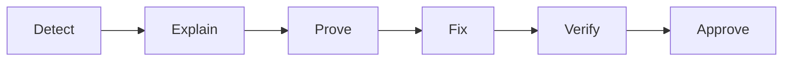

# Diffra

**Visual regressions, found and fixed by your agent.**

Diffra catches every pixel a pull request changes, tells your coding agent exactly why, helps it undo what nobody intended, and proves the fix worked. Self-hosted, and built for CI.

[Fix a regression with your agent](docs/getting-started/agent-quickstart.md) · [Documentation](docs/index.md) · [How it works](docs/concepts/how-diffra-works.md)

---

## From pixel diff to merged fix

Other tools stop at a picture of what changed. Diffra keeps going, and every stage after detection is something an agent can call.

| Stage | What happens |
| :--- | :--- |
| **Detect** | Every pull request is compared with the baseline it branched from, by a Rust engine. |
| **Explain** | Each change is tied to the element, style and stylesheet rule behind it. |
| **Prove** | The suspected cause is undone in the live page, and counts as proven only if the pixels return to the baseline. |
| **Fix** | A proven cause comes with a patch that puts the old values back. |
| **Verify** | A change-scoped re-run reports what is resolved and what is new. |
| **Approve** | What you meant to change becomes the new baseline, by snapshot, with a record of who approved it and why. |

## One regression, start to finish

A design token changes to make buttons roomier. The agent declares that intent, edits, and Diffra runs. The buttons changed as intended. A card did too, and nothing declared covers it. Diffra says why: the card title picked up a new margin from the same token, and undoing that margin restores the card exactly. The agent applies the patch, scopes the margin to buttons, and runs the change-scoped check. The card is resolved and nothing else moved. The agent approves the button snapshots with a rationale, and the pull request shows one intended change and no collateral damage.

Nobody opened a screenshot viewer, and nobody guessed.

## You stay in charge

* **Diffra never calls a model.** It produces evidence and applies decisions. Your agent supplies the judgment.
* **No blind approve button.** Approval names snapshots and follows a policy you set.
* **Honest about certainty.** A cause is attributed until proven, and the report says which.
* **Your data stays yours.** Baselines and reports live on your disk or in your own bucket.

## Built on CI

Diffra runs in your pull request workflow with an official [GitHub Action](docs/ci-cd/github-actions.md), posts a check and a review link on every pull request, and promotes the approved baseline when it merges. Snapshots are unlimited, baselines come from the [merge-base](docs/guides/baseline-management.md), and [sharding](docs/ci-cd/parallel-sharding.md) keeps large runs fast. It reads Storybook, web apps, Playwright tests, Figma and images. See [compatibility](docs/reference/compatibility.md).

## Learn more

* [Agent quickstart](docs/getting-started/agent-quickstart.md): set up the loop in one command.
* [Agent workflows](docs/agents/workflows.md): fixing, redesigns, failing pull requests.
* [Getting started](docs/getting-started/index.md): set up Diffra for your project.
* [Documentation hub](docs/index.md): every page, by goal.

[Contributing](CONTRIBUTING.md) · [Security](SECURITY.md) · [Code of conduct](CODE_OF_CONDUCT.md) · [Packages](docs/architecture/packages.md) · [MIT license](LICENSE)
