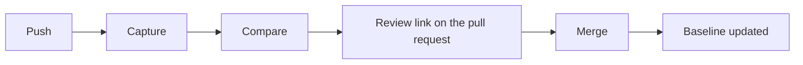

# Diffra

**See every pixel your pull request changes. Ship only the ones you meant to.**

Self-hosted visual regression testing for web apps, design systems and component libraries. Built for CI, and for the agents that work in it.

[Documentation](docs/index.md) · [Get started](docs/getting-started/index.md) · [AI agents](docs/agents/overview.md) · [Reference](docs/reference/index.md) · [Troubleshooting](docs/troubleshooting.md)

---

## Every change, reviewed where you already work

Diffra runs inside your pull request workflow. It captures your UI, compares it with what your base branch accepted, and puts a status check and a link to the review on the pull request. When the pull request merges, what you approved becomes the new baseline. There is no dashboard to log in to and no service to trust with your source.

Read how a run works in [How Diffra works](docs/concepts/how-diffra-works.md), or set up the [GitHub Action](docs/ci-cd/github-actions.md).

## Why teams pick Diffra

| | |
| :--- | :--- |
| **Runs in your pipeline** | An official [GitHub Action](docs/ci-cd/github-actions.md) with status checks, sticky comments and annotations. Any other CI runs the same [CLI](docs/ci-cd/other-ci-providers.md). |
| **Your data stays yours** | Baselines and reports live on local disk or in your own [S3, R2, Google Cloud or Azure bucket](docs/storage-and-plugins/storage-adapters.md). |
| **Unlimited snapshots** | No per-screenshot pricing, no seat licenses, no quotas. Your runner is the only limit. |
| **Fast by design** | A [Rust comparison engine](docs/architecture/core-engine.md) runs off the main thread. Identical images are skipped by hash, so an unchanged UI costs almost nothing. |
| **Reviews people finish** | A calm [review interface](docs/review-ui/overview.md) with four comparison modes, and every change described in plain language. |
| **Reaches what you ship** | Storybook, any URL, Playwright tests, Figma frames and plain image sets, in Chromium, Firefox and WebKit. |
| **Scales with the repo** | [Sharding](docs/ci-cd/parallel-sharding.md) splits a run across jobs. [Monorepo](docs/guides/monorepos-and-workspaces.md) support keeps each package on its own configuration. |
| **Deterministic** | Animations are frozen, regions can be masked, and baselines come from the [merge-base](docs/guides/baseline-management.md), so unrelated changes on main never fail your branch. |

## Built for agents

A screenshot diff tells an agent where pixels moved. Diffra also tells it why, and checks the answer.

* **Explained.** Every changed region is tied to the element, style and stylesheet rule behind it. See [explained changes](docs/agents/explained-changes.md).
* **Proven.** Diffra can undo a suspected cause in the live page and confirm the pixels return to the baseline. See [proof](docs/agents/proof.md).
* **Judged against intent.** Declare what a change should alter, and each difference is classified as intended or collateral. CI can fail only on collateral. See [intent contracts](docs/agents/intent-contracts.md).
* **Fixed and verified.** A proven cause comes with a patch that undoes it, and a re-run shows what is resolved. See [fixes and verification](docs/agents/fixes-and-verification.md).
* **Approved with a record.** Approval names snapshots, follows a policy you set, and logs who approved, why and on what evidence. See [approvals](docs/agents/approvals.md).

All of it is reachable through a [Model Context Protocol server](docs/agents/mcp-reference.md) and a `--json` flag on every command that prints a report. Diffra never calls a model: it supplies evidence, and your agent supplies judgment. Start with the [agent overview](docs/agents/overview.md).

## Works with

| | |
| :--- | :--- |
| **Targets** | [Storybook](docs/getting-started/storybook-quickstart.md), [web apps and routes](docs/getting-started/web-apps-quickstart.md), [Playwright tests](docs/getting-started/playwright-quickstart.md), [Figma](docs/guides/figma-design-qa.md), [image sets](docs/guides/static-images-and-canvas.md) |
| **Storage** | Local disk, Amazon S3 and compatible stores, Google Cloud Storage, Azure Blob. See [storage adapters](docs/storage-and-plugins/storage-adapters.md) |
| **CI** | [GitHub Actions](docs/ci-cd/github-actions.md), [GitLab CI, CircleCI, Bitbucket Pipelines](docs/ci-cd/other-ci-providers.md) |
| **Notifications** | GitHub checks and comments, Slack, or [your own](docs/storage-and-plugins/notifiers.md) |
| **Extensions** | [Custom drivers, storage and lifecycle plugins](docs/storage-and-plugins/custom-plugins-and-drivers.md) |

## Documentation

The [documentation hub](docs/index.md) lists every page. The main entry points:

| I want to | Go to |
| :--- | :--- |
| Set it up for my project | [Getting started](docs/getting-started/index.md) |
| Understand how it works | [Concepts](docs/concepts/index.md) |
| Do a specific task | [Guides](docs/guides/index.md) |
| Run it in CI | [CI/CD](docs/ci-cd/index.md) |
| Review changes | [Review interface](docs/review-ui/index.md) |
| Let an agent handle regressions | [AI agents](docs/agents/index.md) |
| Look up an option or flag | [Reference](docs/reference/index.md) |
| Understand the internals | [Architecture](docs/architecture/index.md) |
| Fix a problem | [Troubleshooting](docs/troubleshooting.md) |

## Packages

| Package | Directory | Role |
| :--- | :--- | :--- |
| `@diffra/cli` | [packages/cli](packages/cli) | The `diffra` command. |
| `@diffra/core` | [packages/core](packages/core) | Runner, drivers, storage, report generation. |
| `@diffra/engine` | [packages/engine](packages/engine) | Rust comparison engine, loaded through Node-API. |
| `@diffra/viewer` | [packages/viewer](packages/viewer) | The review interface. |
| `@diffra/action` | [packages/action](packages/action) | The GitHub Action runner. |
| `@diffra/mcp` | [packages/mcp](packages/mcp) | The agent server and skill. |
| `@diffra/demo-storybook` | [packages/demo-storybook](packages/demo-storybook) | A working Storybook demo. |
| `@diffra/demo-app` | [packages/demo-app](packages/demo-app) | A working web app demo. |

## Project

* [Contributing](CONTRIBUTING.md): set up the repository and open a pull request.
* [Security](SECURITY.md): report a vulnerability.
* [Code of conduct](CODE_OF_CONDUCT.md)
* [Issues](https://github.com/Diffra/core/issues): bugs and feature requests.
* [MIT license](LICENSE)
