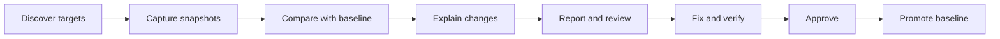

# How Diffra works

A Diffra run turns a set of things you ship into screenshots, compares each screenshot with the one your base branch accepted, and explains the differences. A reviewer or a coding agent then decides what was intended, undoes what was not, and checks the result. Everything else in the documentation is a detail of one of those steps.

## The model

| Object | What it is |
| :--- | :--- |
| Target | One thing to capture: a story, a route, an image file or a Figma frame. A driver discovers targets. |
| Snapshot | A target captured at one viewport in one browser. Snapshots are what get compared and approved. |
| Baseline | The accepted image of a snapshot, stored per commit in your storage. |
| Candidate | The image captured in the current run. |
| Run | One execution. It produces a report, with one result per snapshot. |
| Review bundle | The static review site and report a run writes. Open it, host it, or attach it to a workflow. |

Each result has a status: `unchanged`, `changed`, `added`, `removed` or `failed`. See the [glossary](glossary.md) for the other terms.

## The lifecycle

1. **Discover.** Drivers list targets without running your component code. See [custom drivers](../storage-and-plugins/custom-plugins-and-drivers.md).
2. **Capture.** Each target is rendered in a browser pool at every configured viewport. Animations are frozen and masked regions are covered so the image is repeatable. See [flakiness and determinism](../guides/flakiness-and-determinism.md).
3. **Compare.** The baseline comes from the commit where your branch left the base branch, not from the base branch's newest commit. Identical hashes skip the pixel comparison. Otherwise the [Rust engine](../architecture/core-engine.md) compares the images and groups the changed pixels into regions. See [baseline management](../guides/baseline-management.md).
4. **Explain.** For browser captures, Diffra records what was on the page and says which change in the page accounts for each changed region. See [explained changes](../agents/explained-changes.md).
5. **Report and review.** The run writes a [review bundle](../architecture/review-bundle.md). In CI, a status check and a pull request comment link to it. See the [review interface](../review-ui/overview.md).
6. **Fix and verify.** What was not intended is undone: an agent proves the cause, applies a patch or edits the code, and re-runs only the snapshots its edit can reach. See [proof](../agents/proof.md) and [fixes and verification](../agents/fixes-and-verification.md).
7. **Approve.** A person or an agent accepts the changes they intended. Approval names snapshots and is recorded. See [approvals](../agents/approvals.md).
8. **Promote.** Accepted candidates become the baseline for later runs. In CI this happens when the pull request merges.

## Where a run happens

* **In CI** is the primary home. The [GitHub Action](../ci-cd/github-actions.md) runs on every pull request and every merge. Other providers run the same [CLI](../reference/cli.md); see [other CI providers](../ci-cd/other-ci-providers.md).
* **On a developer machine** is for debugging and for approving locally.
* **From an agent** is where the loop closes. The [MCP server](../agents/mcp-reference.md) works against the local project, where an agent can explain, prove, fix and verify, or against a published review bundle, where it can only read. See [agent workflows](../agents/workflows.md).

## What Diffra does not do

* It does not call a model. It produces evidence and applies decisions; the reviewer or the agent decides.
* It does not run as a hosted service. Baselines and reports live in storage you control.
* It does not accept a whole run on someone's behalf. Approval always names snapshot ids.

## Next

* [Getting started](../getting-started/index.md) to set up a first run.
* [Glossary](glossary.md) for terms.
* [Execution pipeline](../architecture/execution-pipeline.md) for the same lifecycle at the level of code.
